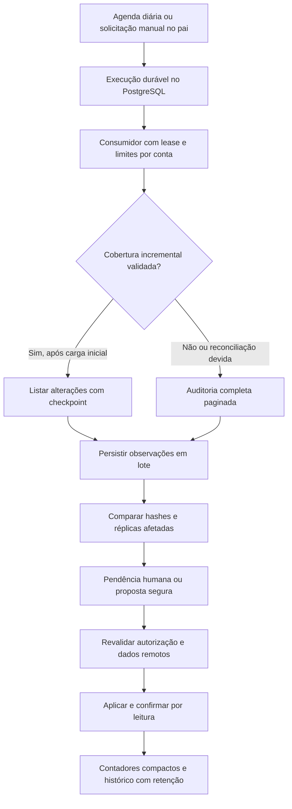

# Planejamento de desempenho e custos da sincronização Olist

Revisão de 16 de novembro de 2026, baseada na implementação local descrita em [Sincronização multiempresa Olist](olist-sync.md). As mudanças abaixo são propostas para a próxima implementação. Esta revisão não modifica código, banco, agendamentos nem infraestrutura.

A prioridade é reduzir trabalho repetido: consultas e gravações por cadastro, auditorias completas diárias e agregações durante o acompanhamento. Manter PostgreSQL como fila durável e estado compartilhado do grupo. Avaliar mudança de infraestrutura somente depois de medir o fluxo otimizado.

## Regras preservadas

- A sincronização ocorre exclusivamente entre filhos diretos habilitados. O pai administra configurações, jobs e permissões; não participa como conta Olist de origem ou destino. Permanecem as exclusões explícitas do grupo inicial.
- Origem do cadastro e última fonte de alteração continuam separadas. Limpeza, replicação e otimização não apagam a proveniência nem tornam a origem uma regra de precedência.
- Preservar os quatro controles em `configuracoes_jobs`, as flags no aplicativo pai e as permissões de visualizar, executar, resolver e configurar. Job ausente ou pausado continua bloqueando a ação correspondente.
- Estoque, preços, custos, tributação e transações permanecem fora do payload. Formas de pagamento e vendedores continuam somente leitura. As restrições de kits, variações e dependências não são removidas por esta revisão.
- Manter autorização vigente, escopo, idempotência, checkpoints, limite de alterações, exclusividade por conta e proteção contra consumidor com lease vencido. Escrita incerta continua exigindo reconciliação; a leitura de confirmação no destino permanece obrigatória.
- Reaproveitar a sincronização nativa Olist quando sua compatibilidade estiver validada. A auditoria local continua necessária para observar o resultado e bloquear conflitos.

## Diagnóstico da versão anterior às correções de consistência

Após esta análise, a correção de consistência passou a compartilhar a elegibilidade entre seleção do grupo e da etapa, resolveu as corridas de encerramento/cancelamento e vinculou identidade e credencial durante aplicação/reconciliação. A validação de chamadas também passou a reutilizar o contexto da reserva, retirando leituras redundantes desse caminho. Esses pontos não devem ser tratados como pendências idênticas às descritas no diagnóstico histórico abaixo. As demais otimizações de lotes, incremental, contadores e retenção continuam propostas.

| Prioridade | Comportamento atual | Impacto e mudança proposta |
| --- | --- | --- |
| P0 | `listar` e `detalhar` em `src/services/olist-sync-service.ts:118` consultam todos os produtos/contatos. A listagem parcial substitui o último detalhe completo. | Chamadas remotas e regravação crescem com o catálogo, mesmo sem mudanças. Separar observação da listagem, validade do detalhe e necessidade de consulta. |
| P0 | `gravarObservacao`, no mesmo arquivo, linha 99, faz pelo menos quatro chamadas Prisma por item comum com chave; a página tem até 100 itens. | Centenas de operações sequenciais dentro de uma transação. Persistir a página em conjuntos limitados, preservando duplicidades e vínculos manuais. Chamada Prisma não equivale necessariamente a um único comando SQL. |
| P0 | `comReserva` em `src/repositories/olist-sync-repository.ts:86` recarrega etapa, execução, configuração e participantes. `dadosReserva` e `contaPermitida` repetem parte dessas leituras. | Mais latência e bytes banco → servidor em cada detalhe. Separar projeções mínimas de controle das informações usadas no planejamento. |
| P0 | A escolha do grupo, no repositório, linha 183, antecede filtros de janela, slots e dependências da escolha da etapa, linha 203. | Um grupo sem condições de executar pode esconder outro pronto. Compartilhar o predicado completo de elegibilidade e ordenar por disponibilidade/antiguidade. |
| P1 | `comparar`, no serviço, linha 161, consulta réplicas separadamente para até 25 registros e decifra observações completas. | Consultas N+1 e transferência de conteúdo sem alteração. Carregar hashes e metadados em lote; buscar conteúdo somente quando a decisão exigir. |
| P1 | O resumo em `src/app/api/olist/sincronizacao/[[...recurso]]/route.ts:68` agrega estados e conta pendências; a tela consulta esse resumo durante execução ativa. | O custo de acompanhar um job cresce com o catálogo e o número de usuários. Polling deve consultar execução e contadores compactos. |
| P1 | A limpeza remove até 500 itens por categoria e registra a tentativa como concluída para a janela diária. | O backlog pode crescer se a geração exceder a remoção. Continuar em passagens limitadas quando houver mais registros vencidos. |

O cron do módulo está configurado a cada minuto em `vercel.json`: 1.440 chamadas agendadas por dia, aproximadamente 43.200 em 30 dias. O consumidor inicia etapas dentro de um orçamento de 240 segundos, com margem final de 120 segundos, e admite esperas curtas de até 12 segundos. Não é um job que necessariamente permanece ativo por quatro minutos em cada chamada.

## Arquitetura mantida e ajustes do fluxo

Preservar um registro lógico por grupo/entidade/chave e um estado por participante. Para K chaves e N participantes, o estado cresce aproximadamente com K × N, sem catálogos completos por par nem cópias diárias. Operações continuam por destino, porque cada efeito exige controle independente.

A aplicação revalida as réplicas para cada destino. Na versão original, o caminho normal de uma atualização somava aproximadamente `2N + 2` chamadas por destino. Com a proteção que vincula `/info` à credencial de cada leitura/escrita, são aproximadamente `2N + 4`; propagar a N−1 destinos soma `2N² + 2N − 4`, sem retries. O acréscimo protege escrita e confirmação contra troca de conta; as verificações separadas de conta foram substituídas, não acumuladas. Assim, o estado armazenado é linear por participante, mas as chamadas de aplicação podem crescer quadraticamente. Após o piloto com duas/três contas, medir propostas repetidas e revalidações. Uma proposta canônica por revisão, referenciada pelos destinos, pode reduzir duplicação; qualquer reaproveitamento de leituras exige validar versão, conexão e consistência. Não remover a revalidação do destino nem a confirmação posterior para atingir uma meta de economia. Permanece a janela de concorrência externa entre GET e PUT quando o contrato utilizado não fornece escrita condicional.

## 1. Reduzir consultas e escritas no banco

**Persistência em lote.** Pré-carregar os estados e vínculos da página, identificar duplicidades no lote e no banco e executar inserções/atualizações parametrizadas em conjunto. Manter o checkpoint na mesma transação dos resultados. Não substituir o laço por cem promises concorrentes. Limitar itens e bytes; iniciar com página remota de 100, persistência limitada a 1 MiB por lote, com tratamento explícito para item que exceda o limite. Se a página exigir sublotes, registrar o progresso interno e só avançar o cursor remoto após persistir a página inteira. Nunca descartar silenciosamente um cadastro grande.

**Observação sem regravação de conteúdo.** Calcular uma vez a normalização e um HMAC versionado da observação relevante. Se conteúdo, identidade, situação, pendências e versão de normalização forem iguais, preservar o ciphertext e atualizar apenas metadados necessários. Nunca reutilizar nonce para uma nova cifragem. A listagem não deve substituir o último detalhe completo por um resumo nem mudar automaticamente um registro equivalente para divergente. Preservar o detalhe anterior não o torna verificado na execução atual: sem cobertura ou sinal remoto confiável, consultar o detalhe novamente antes de utilizá-lo para uma decisão.

**Comparação por lote.** Buscar até 25 registros e suas réplicas em até duas consultas de carga, com limite de bytes e de participantes compatível com a configuração. Incluir observações da mesma chave sem vínculo com o registro lógico, para não esconder duplicidades. Consultar hashes e indicadores de cobertura primeiro. Buscar e decifrar dados apenas para divergências, ausência, pendências ou construção de payload. Campos necessários à segurança da decisão precisam estar incluídos no fingerprint ou nos metadados; igualdade de hash de poucos campos não comprova elegibilidade para escrita.

**Controle enxuto e atual.** Validar lease/token e obter apenas IDs, versão, status e gates necessários. Consolidar a verificação de usuário, grupo, job e reserva da conta, sem cache de autorização entre chamadas. Manter a revalidação antes de cada chamada remota e especialmente antes da escrita. Persistência e liberação/checkpoint podem compartilhar transação quando isso preservar o tratamento de respostas incertas. Nenhuma chamada HTTP deve ocorrer dentro da transação de persistência do lote.

**Contadores e manutenção.** Atualizar contadores por checkpoint confirmado, na mesma transação, sem duplicá-los em retries. Recuperação global de leases e tratamento de pausas rodam uma vez por passagem limitada do consumidor, em vez de varrer globalmente a cada item; gates locais continuam presentes em cada reserva. Finalização precisa continuar correta após queda entre etapas.

**Índices dirigidos às consultas.** Medir planos com dados locais representativos antes de acrescentar índices. Candidatos: detalhamento pendente por grupo/conta/entidade, seleção de etapa elegível, operações por destino/status, pendências por grupo/status/ordenação e FK `origem_execucao_id` usada na limpeza. Reutilizar índices existentes; índices adicionais também ampliam escrita e armazenamento. Se a cobertura incremental exigir campos próprios, preferir campos tipados para os filtros críticos a varreduras recorrentes de JSON.

## 2. Auditoria incremental com cobertura explícita

O transporte local já reconhece filtros de data, mas o consumidor executa somente auditoria completa. A implementação atual considera `ultimaExecucaoId` diferente da execução corrente como falta de observação e pode produzir uma suspeita de remoção. Portanto, **passar apenas o filtro de data ao cliente seria incorreto**.

Planejar quatro informações distintas, por conta e entidade:

1. Cobertura da coleta: completa ou incremental, versão da política e janela consultada.
2. Última observação na listagem e geração da última varredura completa em que o registro apareceu.
3. Último conteúdo completo válido, fingerprint e necessidade de detalhamento.
4. Registros efetivamente alterados/afetados nesta execução e watermark confirmado após persistência integral da coleta.

Regras para habilitar:

- Carga inicial completa obrigatória. Validar por conta/entidade a semântica do filtro, fuso, precisão, paginação, inclusão dos limites e cobertura de campos/subrecursos. Um timestamp do resumo só pode dispensar detalhe se houver evidência de que representa todas as alterações relevantes. Mudança apenas em estoque pode ainda exigir consulta se a API não distinguir o motivo.
- Consultar desde o último watermark confirmado com uma sobreposição compatível com a precisão e o atraso observados. O limite inferior não avança por página. Ao concluir, avançar no máximo até o início da coleta; se houver limite superior suportado e validado, usá-lo. Persistir cursor e resultado atomicamente, deduplicar por conta/entidade/ID e testar alterações durante a paginação.
- Se não for possível assegurar completude da paginação ou do filtro, manter coleta completa para aquela conta/entidade. Não presumir ETag, webhook, ordenação ou limite superior que o contrato não garanta.
- Ausência na consulta incremental significa “não retornado nessa janela”, nunca “removido”. Estados completos anteriores permanecem utilizáveis conforme a cobertura validada. Falha de uma conta não permite tratar seus cadastros como inexistentes.
- Comparar a união das chaves afetadas, incluindo correspondências antigas e novas quando uma identidade mudar, pendências relevantes e dependências impactadas. Antes de escrever, reconsultar fonte/destino e invalidar a proposta se suas pré-condições mudaram.
- Inicialmente propor uma auditoria incremental por dia e uma completa a cada sete dias, substituindo a incremental daquele dia. As entidades sem cobertura incremental confiável mantêm auditoria completa diária; formas de pagamento e vendedores seguem sua capacidade própria.
- Na completa periódica, ausência exige confirmação antes de qualquer decisão. Exclusões e inativações continuam sem propagação automática. A origem observada só pode ser inferida com cobertura completa suficiente; um delta não redefine origem.

O intervalo de sete dias é uma proposta de política: ausências detectáveis apenas por varredura e falhas até então desconhecidas na cobertura do filtro podem levar até sete dias para aparecer, além do tempo de execução e eventuais falhas. Campos relevantes comprovadamente fora do filtro impedem habilitar esse incremental como substituto da auditoria diária; nesse caso, manter coleta completa diária. Se o negócio exigir detecção diária também das ausências, manter reconciliação diária ou validar outro sinal confiável. A tela deve mostrar a última coleta incremental e a última cobertura completa separadamente.

## 3. Consumidor e infraestrutura

**Primeiro manter o consumidor atual.** Criar uma verificação inicial barata para trabalho elegível, agenda vencida e manutenção devida. Sem trabalho, retornar imediatamente, sem carregar catálogo, cifrar dados ou repetir varreduras. Meta inicial: até três consultas pequenas nesse caminho, sem contar autenticação externa quando houver. Manutenção vencida não pode ser ignorada por uma fila aparentemente vazia.

Unificar elegibilidade entre seleção do grupo, reserva de etapa e próxima janela. Usar disponibilidade e antiguidade para justiça entre grupos. Preservar uma chamada por conta e até duas contas por grupo; esse limite permite concorrência, mas não comprova duas chamadas simultâneas no laço atual. Medir a vazão antes de implementar paralelismo adicional. O limite de API também precisa considerar outros consumidores da mesma conta.

Não aumentar o cron de um para cinco minutos enquanto ele for o único consumidor sem avaliar o atraso. Isso reduziria chamadas agendadas de 43.200 para 8.640 em 30 dias, mas poderia acrescentar espera em retomadas e execuções manuais. O primeiro ganho deve ser reduzir o custo da passagem vazia e das etapas úteis.

Na Vercel, cron usa os recursos da Function invocada. Se o projeto usar Fluid Compute, CPU ativa e memória provisionada são dimensões distintas: aguardar I/O não consome cobrança de CPU ativa, mas a memória permanece provisionada enquanto a instância atende requisições. Medir ambos antes de concluir que esperas curtas são caras ou gratuitas. [Cron e cobrança](https://vercel.com/docs/schedules/cron-jobs/usage-and-pricing), [Fluid Compute](https://vercel.com/docs/functions/usage-and-pricing).

Depois de otimizar e medir, comparar o consumidor Vercel com um processo Node dedicado em infraestrutura já disponível, caso exista capacidade comprovada. O repositório contém workers, como `scripts/automatizacao-worker.ts`, mas eles não são consumidores prontos desta fila. Reutilizar uma máquina não significa executar sincronização via IA/browser nem adicionar chamadas pagas de modelo. Seriam necessários processo supervisionado, segredos isolados, conexão limitada, encerramento seguro e métricas. Considerar também manutenção, disponibilidade e contenção com outros processos.

Confirmar região de aplicação/banco, modo real de execução, plano e conexões do deployment. Dimensionar o pool pelo total de instâncias × conexões por instância, incluindo outros workers. Testar compatibilidade de transações e locks antes de mudar a conexão. O pooler administra conexões; não elimina dados retornados pelas consultas. [Conexões PostgreSQL no Supabase](https://supabase.com/docs/guides/database/connecting-to-postgres).

Redis, nova VM, fila externa, réplica de leitura, Realtime e migração de provedor ficam fora da primeira etapa. Só entram se resolverem um limite medido com custo total menor. Preservar as abstrações pequenas já existentes de cliente, serviço e repositório.

## 4. Painel e retenção

O acompanhamento usa status, fase e contadores da execução, sem `groupBy` do catálogo em cada poll. Manter intervalo inicial de dez segundos durante execução ativa, backoff em falhas, suspensão com página oculta e encerramento quando o job terminar. Recalcular totais na entrada, solicitação explícita e conclusão; indicar quando foram atualizados. A resposta de progresso deve ter tamanho limitado independentemente do número de cadastros.

Nas listagens, preservar padrão de 25 e máximo de 100 itens, campos explícitos e detalhes sob demanda. Planejar paginação por cursor com ordenação estável para evitar offsets profundos. Manter compatibilidade do contrato existente durante a transição; totais exatos podem ser obtidos na entrada/troca de filtro, sem obrigar uma contagem completa em toda navegação. Cache compartilhado não é necessário inicialmente. Qualquer reutilização futura deve ser restrita por grupo, filtro e versão, com autorização atual antes do acesso.

Manter as retenções atuais: eventos técnicos 30 dias, decisões humanas 365, operações/execuções concluídas 90 e payloads concluídos 30. Se a passagem atingir o limite de remoção, programar continuação próxima, com checkpoint e orçamento de tempo, em vez de esperar 24 horas. Começar com lotes de até 500 e orçamento alvo de cinco segundos por passagem; ajustar com medição. Verificar o tempo antes de cada lote, aplicar `statement_timeout` e `lock_timeout` compatíveis com o saldo e reservar margem para commit/rollback. Um timer JavaScript sozinho não limita uma consulta em andamento. Em timeout, preservar a continuação da transação não confirmada. Pendências abertas, operações inconclusivas, estado atual e origem permanecem protegidos. Uma passagem que não esgotou a fila não representa limpeza completa.

Monitorar crescimento de tabela, índices e backlog vencido. Remover linhas torna espaço reutilizável pelo PostgreSQL; não pressupor redução imediata do volume provisionado ou da fatura. Evitar particionamento ou compactação adicional sem evidência de necessidade.

## 5. Configurações propostas

Os nomes abaixo são contratos propostos, ainda não implementados. Validar limites no servidor e versionar as políticas; alterações que afetem a interpretação dos dados invalidam propostas antigas e podem exigir nova auditoria completa.

| Local | Parâmetro ou responsabilidade | Proposta inicial |
| --- | --- | --- |
| `configuracoes_jobs` | Pausa/liberação dos quatro jobs existentes | Preservar controles globais e criação pausada; não criar um job por empresa ou por SKU |
| Aplicativo pai | Flags e permissões de usuário | Preservar administração central; nenhuma permissão nova concedida automaticamente |
| Configuração do grupo | Modo de auditoria por entidade | Completo por padrão; incremental somente após validação da conta/entidade e nova implementação |
| Configuração do grupo | Intervalo da reconciliação completa | Proposta de sete dias para entidades elegíveis; diário onde cobertura ou requisito exigir |
| Configuração do grupo | Sobreposição e watermark por conta/entidade | Derivados da precisão validada; persistência durável e exibição da cobertura |
| Política do consumidor | Limites de lote, bytes, concorrência e tempo | Página 100, comparação 25, persistência inicial de 1 MiB, uma chamada por conta e até duas contas por grupo |
| Política operacional | Orçamento de chamadas e alertas de atraso | Definir a partir do catálogo e da cota disponível; ao atingir limite, checkpoint e retomada, nunca sucesso parcial silencioso |
| Limpeza | Continuação e orçamento | Lotes de 500, nova passagem se houver backlog, orçamento inicial de cinco segundos |

Preservar limites atuais de alterações por destino. A auditoria deve concluir a cobertura necessária antes de liberar escrita. Se o orçamento do dia não comportar a coleta, mostrar atraso/cobertura incompleta e manter as operações dependentes bloqueadas.

## 6. Cenários de capacidade e transferência

Estimativas para **duas contas, somente produtos, após carga inicial**, páginas de 100 com total conhecido, uma leitura de identidade por conta/entidade e sem retries ou escritas. K representa produtos por conta; D, produtos efetivamente retornados como alterados por conta, já considerando a janela consultada.

`GETs completos = 2 × (1 + ceil(K / 100) + K)`

`GETs incrementais = 2 × (1 + ceil(D / 100) + D)`, para D maior que zero. Uma consulta sem mudanças ainda precisa consultar a primeira página. Os cálculos usam o contrato atual, que exige `paginacao.total`; suportar uma resposta sem total exigiria validação e alteração explícita desse contrato.

| Cenário | 1.000 produtos por conta | 10.000 produtos por conta |
| --- | ---: | ---: |
| Uma auditoria completa | 2.022 GETs | 20.202 GETs |
| Incremental com 1% efetivamente retornado | 24 GETs | 204 GETs |
| Incremental com volume dobrado pela sobreposição | 44 GETs | 406 GETs |
| Sete completas por semana | 14.154 GETs | 141.414 GETs |
| Seis incrementais de 1% e uma completa por semana | 2.166 GETs | 21.426 GETs |
| Redução calculada no ciclo semanal | 84,70% | 84,85% |

Com sobreposição dobrando os itens, a redução semanal calculada cai para aproximadamente 83,85% e 83,99%. Outros cadastros, duplicidades, validações, alterações reais, chamadas de aplicação e recuperação somam consumo. A reconciliação completa ainda exige capacidade para seu pico; a média semanal não dimensiona esse dia.

Com dez leituras por minuto por conta, a auditoria completa de produtos tem um piso aproximado de 101 minutos para mil produtos e 1.010 minutos, cerca de 16h50, para dez mil produtos por conta. São limites ideais de capacidade, não previsão de duração: latência, banco, compartilhamento da cota, retomadas e concorrência efetiva podem aumentar o tempo. Não elevar o limite para compensar banco ineficiente sem validar a cota remota.

Admitindo detalhes médios de 4 KB decimais, duas contas com mil produtos transferem aproximadamente 8 MB de detalhes por completa; com dez mil, 80 MB. Isso é **Olist → servidor**, não uma medição de egress Supabase. Listagens, headers e outros fluxos não estão incluídos.

Medir separadamente:

- **Olist → servidor:** requisições e bytes por entidade, chamadas evitadas, 429 e retries. Tráfego recebido não deve ser rotulado automaticamente como saída faturada do banco.
- **Supabase → servidor:** projeções de consultas, hashes, payloads e resultados de mutações. Reduzir o JSON do navegador não reduz o que já saiu do banco. A saída via pooler também participa do egress segundo a modalidade usada. [Egress Supabase](https://supabase.com/docs/guides/platform/manage-your-usage/egress).
- **Servidor → navegador/Olist:** respostas de acompanhamento, detalhes abertos sob demanda e payloads de escrita.
- **Computação e armazenamento:** CPU, memória provisionada, conexões, duração de transações, WAL, tamanho de tabelas/índices e logs. Uma redução de queries não implica cobrança por query nem economia imediata em compute fixo.

Para avaliar economia financeira, comparar uso antes/depois com plano, créditos, franquias, região e preços vigentes. Esta revisão estima operações e tráfego ilustrativo; não atribui valores monetários nem promete redução percentual da fatura.

## 7. Ordem de implementação e critérios de aceite

| Etapa | Entrega | Evidência necessária |
| --- | --- | --- |
| A | Instrumentação agregada, caminho ocioso barato e elegibilidade justa | Métricas por execução/entidade sem payloads, documentos ou tokens; grupo B pronto executa mesmo com A bloqueado; nenhuma espera ativa com todos os jobs pausados |
| B | Projeções mínimas, persistência em lote, fingerprints e comparação em lote | Meta de até 12 comandos SQL emitidos pela aplicação para persistir lote comum de 100 itens dentro de 1 MiB, incluindo BEGIN/COMMIT; autorização e reserva medidas à parte. Até duas consultas de carga para registros e réplicas de 25 chaves; medir exceções e lotes fracionados separadamente |
| C | Cobertura e incremental por conta/entidade, com fallback completo | Mesmo estado final da referência completa nas fixtures; registros não retornados não viram removidos; cursor só avança após commit; invalidação de política e troca de conta forçam cobertura adequada |
| D | Polling compacto, paginação por cursor e limpeza com continuação | Polling sem agregação do catálogo, resposta com limite constante; backlog sintético de 5 mil vencidos drenado em passagens limitadas; origem e operações inconclusivas preservadas |
| E | Piloto e escolha do executor conforme medição | Comparação de duração, CPU/memória, banco, transferência e atraso da fila; nenhuma troca de infraestrutura sem benefício demonstrado |

Metas adicionais para B: reduzir em pelo menos 50% as consultas e os bytes banco → servidor por detalhamento no cenário sem erro, comparando com o baseline medido; numa segunda auditoria idêntica, manter os ciphertexts dos conteúdos iguais e produzir zero escritas Olist. Atualizações pequenas de metadados ainda são esperadas. Essas metas são critérios de engenharia, não resultados já obtidos.

Usar fixtures de duas e três contas, com 1 mil e 10 mil registros por conta, cenários de 0%, 1% e 100% de alteração, duplicidades e documentos inválidos. Validar atraso/precisão do filtro, alterações durante paginação, identidade alterada, concorrência, pausa, revogação, lease vencido, rollback, retry esgotado, 429 e escrita incerta sem repetição. Comparar modos completo/incremental e conservar a matriz de testes de isolamento do pai.

Coletar contagem real de comandos SQL, bytes serializados identificados como aproximação quando não houver medição de rede, `EXPLAIN (ANALYZE, BUFFERS)` em banco local descartável, CPU, duração e WAL. Métricas devem ser agregadas por execução/lote, com cardinalidade limitada; evitar log por cadastro e uma escrita de telemetria para cada consulta.

Na interface, verificar larguras de 360–390 px e 1280–1440 px, temas claro/escuro, teclado, filtros, próxima página e estados de espera/erro/fim. Exibir cobertura e atualização dos totais sem confundir enfileiramento com conclusão. Alterações exclusivamente documentais desta revisão não exigem nova execução da suíte.

## Decisões para a próxima implementação

A recomendação é executar A e B primeiro, mantendo a fila e os controles atuais. Depois, liberar C somente nas contas/entidades com contrato validado e executar D. A política semanal troca menor volume por maior prazo de detecção de ausências; essa escolha precisa ser aceita antes de ativá-la. Escolha de novo executor, eventual aumento de orçamento e qualquer implantação em produção ficam condicionados às medições e à autorização da etapa correspondente.

Nesta revisão foram examinados código e documentação oficial. Não foram consultados catálogos Olist, métricas de faturamento, configuração efetiva do deployment ou capacidade de máquinas em produção. As lacunas relevantes são a cobertura real dos filtros, o volume por entidade, a taxa de mudanças, a cota compartilhada e o custo observado do executor.
